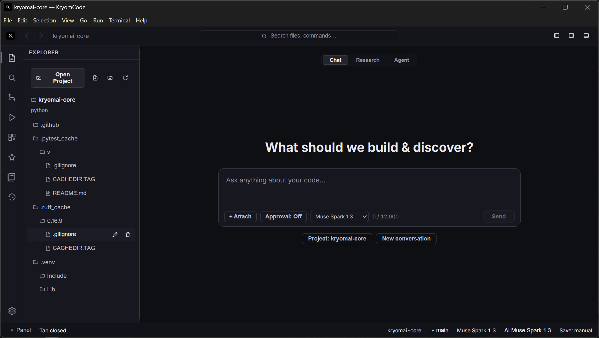
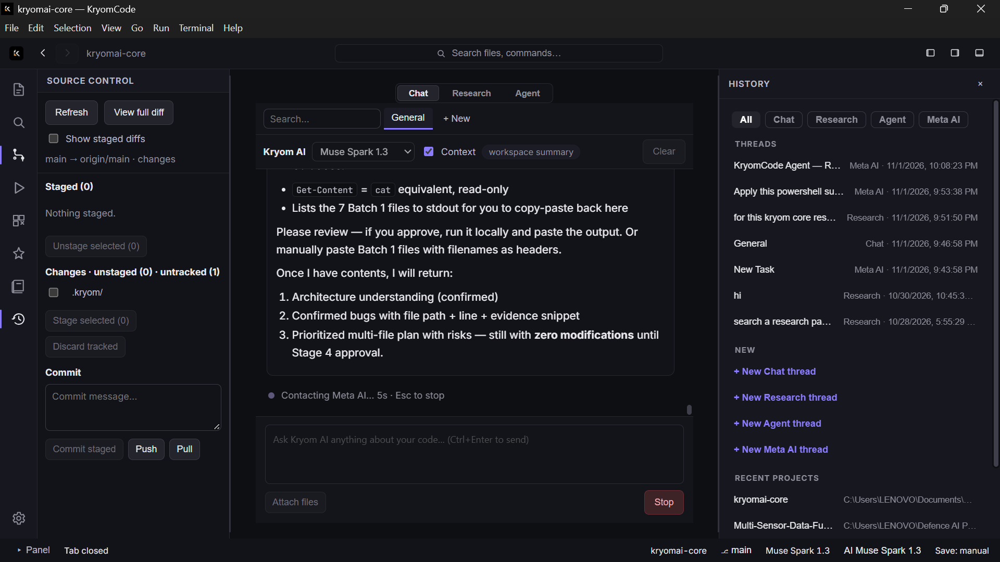
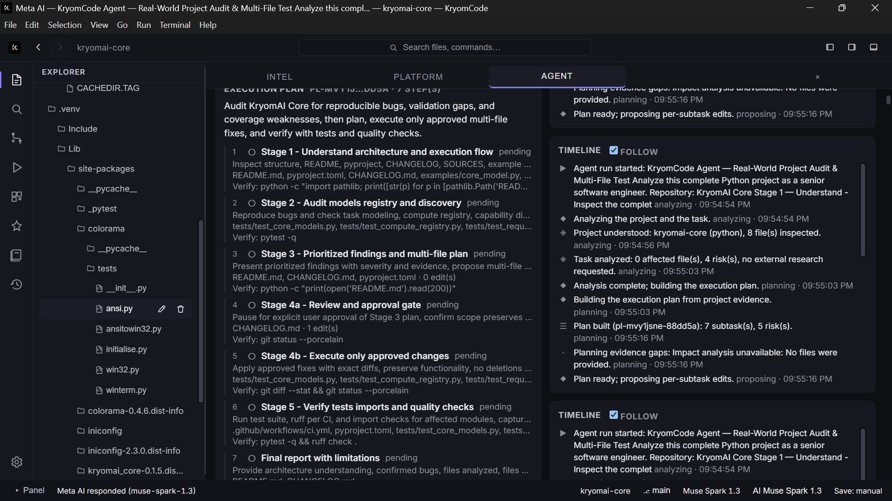
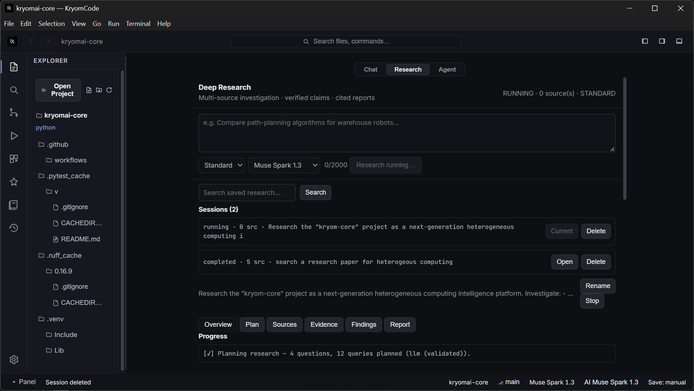
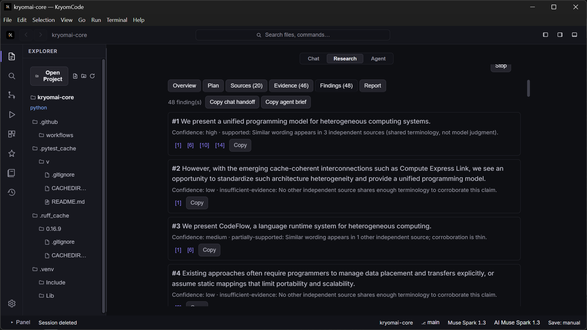
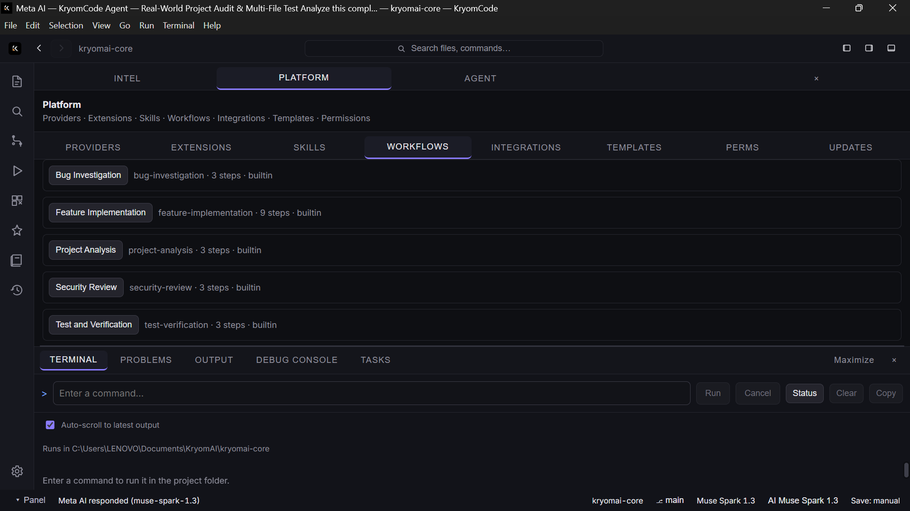
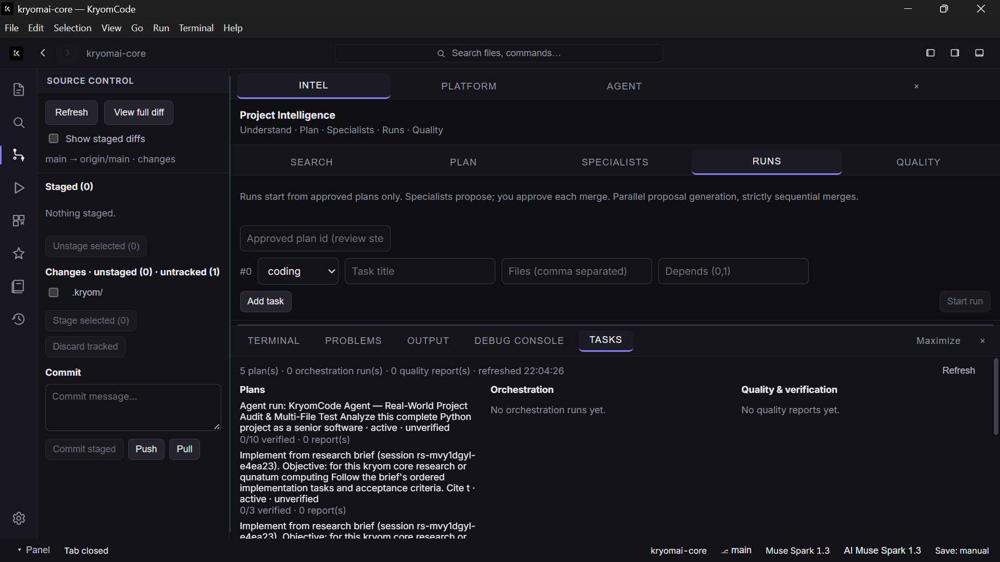
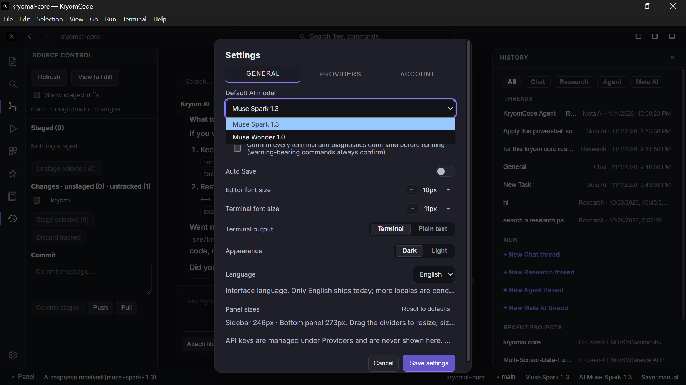

# KryomCode


**Research → Understand → Plan → Review → Execute → Verify**

*"For science builders who need every AI-assisted change grounded in
evidence, reviewed with intent, and verified before execution."*

KryomCode is an AI-assisted coding and scientific research desktop
workspace. It keeps the whole development chain in one Meta-first
environment: research with cited sources, source-grounded plans,
diff review, explicit approval, then verified execution — so every
change traces back to the research and checks behind it.

Repository: [github.com/KryomLabs/kryomcode](https://github.com/KryomLabs/kryomcode) ·
Demo: [watch on YouTube](https://youtube.com/watch?v=M_3XuU4IjLg&si=ACuwD24IQLAMK39-) ·
Entered in the Meta Global AI Developer Hackathon 2026, Indie
Developer (Individual/Solo) track.

> Prerelease: version 0.1.0 (MIT). No installers are published yet —
> install from source or build one locally (see Installation).
> A v0.1.0 Windows installer has been built, validated, and
> install-tested, but the GitHub release is still a draft, so no
> public download exists yet. Anything still pending is called out
> in this README and in
> [docs/backend-limitations.md](docs/backend-limitations.md).

## Demo video

Watch the official KryomCode hackathon demo on YouTube:

[](https://youtube.com/watch?v=M_3XuU4IjLg&si=ACuwD24IQLAMK39-)

*Preview still from the workbench (gallery image 01). Click to watch
the video on YouTube:
https://youtube.com/watch?v=M_3XuU4IjLg&si=ACuwD24IQLAMK39-*

- H.264 1920×1088 @ 25 fps, AAC stereo audio, 2:16 (135.96 s).
  Recorded 2026-11-02 following
  [docs/DEMO_VIDEO_SCRIPT.md](docs/DEMO_VIDEO_SCRIPT.md).

## Why KryomCode exists

Research usually dies in browser tabs: papers get read, then
implementation starts from a blank file with no trace back to the
evidence. Meanwhile AI coding tools either act without review or
bury their reasoning where it cannot be checked. The result is
code nobody can audit: no sources, no plan record, no proof that
verification actually ran.

KryomCode exists to close that gap — one workspace where AI
assistance is always proposed, reviewed, approved, and verified,
with the evidence kept alongside the code.

## Our vision

Make advanced research and engineering workflows more accessible,
transparent, and verifiable.

KryomCode is built toward a workspace where a single builder can
move from a research question to reviewed, verified implementation
without losing the chain of evidence — and where every AI
suggestion arrives with its reasoning visible and its execution
gated behind human approval. The long-term vision is
evidence-driven AI-assisted engineering and scientific research:
see the full statement in
[docs/VISION.md](docs/VISION.md).

## What is KryomCode?

KryomCode is a review-first companion for evidence-backed
development (it does not claim to replace every IDE or coding
agent). Its differentiators are all implemented and
evidence-backed:

- A fixed Meta AI provider integration with an honest capability
  catalog — no silent fallbacks, no invented model properties.
- Research whose citations must resolve to retrieved sources, or
  the brief honestly falls back to extractive quotes.
- An approval-gated multi-file agent with freshness checks,
  conflict protection, checkpoints, and undo.
- Verification reports derived from observed run facts — exit
  codes and run ids — never from model prose.

The developer stays in control throughout: the agent only proposes
plans, every file edit needs explicit approval, and terminal, Git,
and file operations each require an explicit user action.

## Core capabilities

- **Meta AI chat** — Center-stage chat on `muse-spark-1.3`
  (default) or `muse-wonder-1.0`, per-request picker, workspace
  context (active file or project summary), research-brief
  context, per-project history, Stop/cancel, 12,000-char prompts.
- **AI agent** — Task → validated plan → per-edit approval →
  atomic apply with rollback, checkpoints plus per-item Undo,
  freshness protection against external edits, verification and
  repair cycles, persisted plan records with risks, steps,
  evidence, and reports. At most 20 file edits and 10 suggested
  commands per plan.
- **Research workspace** — Visible run steps with cancel/resume,
  persisted sessions and cited markdown briefs, source list with
  browser open, `.docx` export, and "Implement from Research"
  handoff to the agent. Real providers: arXiv, OpenAlex,
  Crossref, Semantic Scholar, and DuckDuckGo keyless; Tavily
  optional with a key.
- **Evidence and citations** — Citation markers resolve to
  retrieved sources; claim verification is lexical and labeled
  as such; model text in reports is marked AI-generated, never
  proof.
- **Approval-gated execution** — Plans propose, humans approve:
  per-edit selection, confirm dialogs for apply/run/skip/undo,
  native main-process approval for destructive terminal commands
  that a compromised renderer cannot skip.
- **Monaco editor** — Multi-tab editing with dirty tracking,
  session restore, mtime conflict dialogs, Save As, Auto Save,
  close guard, bundled locally (no CDN) with same-origin
  workers, Problems gutter markers with F8 navigation. Files
  capped at 1 MB.
- **Integrated terminal** — One explicit run per command in the
  project folder, 120 s timeout, 100 KB output cap,
  secret-scrubbed environment, advisory destructive-pattern
  warnings, cancel/status, history recall, auto-scroll toggle.
  Buffered transcript results rendered with xterm.js (it is not
  an interactive PTY).
- **Git source control** — Status, diffs, stage/unstage, discard
  (tracked only, confirmed), commit, push, fast-forward-only
  pull, remotes with userinfo redaction, `ls-remote`
  verification, restricted clone (GitHub HTTPS/SSH or local
  folders). Ambient credentials only — never handled by the app.
- **Checkpoints, rollback, verification** — Every apply persists
  pre-apply bytes with digest-checked undo; failures roll back
  with honest counts; verification runs link observed run ids,
  exit codes, and diagnoses to plan reports. Stale or
  interrupted steps are flagged, never silently completed.
- **Platform** — Local-only extensions (manifest validation,
  disabled-by-default, worker-process isolation, capability
  permissions), skills, explicit-advance workflows, local-git
  integrations, preview-before-confirm templates.

## The KryomCode workflow

**Research → Understand → Plan → Review → Execute → Verify**

1. **Research** — Investigate through real search providers.
   Sessions persist with cited briefs; every `[n]` citation must
   resolve to a retrieved source or the brief falls back to
   extractive quotes.
2. **Understand** — Project intelligence indexes the codebase
   (symbols, semantic search, impact analysis, architecture)
   with quoted evidence and staleness reporting.
3. **Plan** — The agent proposes a bounded JSON plan grounded in
   selected source files, the workspace summary, and optionally
   the research brief and chat.
4. **Review** — Each edit shows a Why rationale plus diff;
   change-set analysis orders dependent edits; same-file
   conflicts block Apply.
5. **Execute** — Apply writes only the edits you selected, after
   re-validating every path and freshness digest, with rollback
   on failure and a checkpoint (undo) per batch. Planned
   commands are never executed automatically.
6. **Verify** — Run build/test commands through the guarded
   terminal, get parsed Problems plus a classified diagnosis,
   and record verification reports on the plan. Stale or
   interrupted steps are flagged, never silently completed.

## Why it matters for science and engineering builders

KryomCode is designed for builders whose work has to be
checkable: robotics, quantum computing, scientific computing,
machine learning, and aerospace are the intended application
areas. These are directions for the product, not claims that
every specialized workflow is already implemented — what exists
today is the evidence discipline those fields demand: sourced
research, reviewed plans, approved execution, and reports pinned
to observed runs.

A failed check enters a bounded repair cycle (2 attempts,
10-minute budget) with per-attempt approval, so even recovery
stays reviewable.

## Product screenshots

Real captures from the running app (dark theme, `kryomai-core` demo
project). Full inventory with per-image notes:
[docs/SCREENSHOT_GUIDE.md](docs/SCREENSHOT_GUIDE.md).

**Workbench and chat**


*Main workbench — welcome view with Chat/Research/Agent modes, Explorer,
prompt box, and per-request model picker.*


*Meta AI chat — live request with elapsed timer and Stop, workspace
context chips, and filterable thread history.*

**Agent and research**


*Agent planning — staged execution plan with per-stage files and Verify
commands, explicit approval gate, and live run timeline.*


*Research workspace — persisted sessions, validated multi-query
planning progress, and the Overview-to-Report tab flow.*


*Research findings — confidence-graded claims with numbered citations
and one-click handoff briefs for chat and the agent.*

**Terminal, Git, and configuration**


*Integrated terminal — one-shot reviewed execution with Run/Cancel/
Status/Clear/Copy, above the Platform workflows tab (idle state).*


*Git source control — staged/unstaged/untracked, commit, Push/Pull,
plus the Tasks panel with plan verification states.*


*Model configuration — Settings picker with both Muse models; API
keys are managed under Providers and never shown.*

Nine supplementary shots (editor workspace,
grounding honesty, error state, Intel runs, code answer,
pending-approval honesty, research sources, cited brief, terminal
output log) stay in `docs/images/` outside the gallery.

## Technology stack

Three layers, one trust direction — the renderer never touches
disk, network, or secrets:

```text
Renderer (React, sandboxed)      Preload            Main (Node + Electron)
src/app/App.tsx ──► kryom() ──► window.kryom ──► ipcMain.handle ──► service ──► disk / git / Meta API
```

| Piece | Location | Runs where |
|---|---|---|
| Window + lifecycle | `electron/main.cjs` | Main |
| Capability bridge | `electron/preload.cjs` (~200 typed methods) | Preload (no Node APIs) |
| Channel wiring | `electron/ipc/register-handlers.cjs` + 15 domain modules | Main |
| UI shell | `src/app/App.tsx` | Renderer |
| Typed bridge access | `src/api/kryom.ts`, `src/electron.d.ts` | Renderer |

- Stack: Electron 45, React 19 + TypeScript 5.7 (strict), Vite 6,
  Monaco Editor (locally bundled), xterm.js transcript renderer,
  `node:test` backend suite + Vitest renderer suite,
  electron-builder 26.
- Every IPC handler first checks the sender is the app's own main
  frame, then validates its payload; only human-readable messages
  return to the renderer.
- Domain logic lives in `electron/services/` (workspace,
  filesystem, terminal, ai, agent, git, diagnostics,
  project-intelligence, research, memory, settings, extensions,
  skills, workflows, integrations, templates, platform, release,
  context, crash, and more).
- All path operations resolve through workspace containment
  (traversal rejected, symlinks refused); per-project state lives
  in `.kryom/` (git-ignored, never committed).
- Details: [docs/ARCHITECTURE.md](docs/ARCHITECTURE.md),
  [docs/PROJECT_STRUCTURE.md](docs/PROJECT_STRUCTURE.md).

## Meta AI integration

| Model ID | Role |
|---|---|
| `muse-spark-1.3` | Default for chat, agent, research synthesis, settings |
| `muse-wonder-1.0` | Selectable via settings or per-request override |

- Fixed endpoint `https://api.meta.ai/v1/chat/completions`,
  temperature `0.2`, 90-second timeout, redirects refused — none of
  this is configurable, by design.
- Model ids are an allowlist derived from the provider descriptor;
  unknown ids are rejected with the supported values listed.
- Routing never falls back silently: without an explicitly
  configured standby, an unusable provider fails with an error
  naming the cause.
- The catalog is honest: single-shot text only
  (`streaming: false`), unknown context windows stay `null`,
  never invented. Chat does not stream; a slow request shows an
  elapsed timer, not fake tokens.
- Keys resolve through a two-name allowlist (`MODEL_API_KEY`,
  `TAVILY_API_KEY`): environment first, then the OS-encrypted
  vault (Settings → Providers). Key material never crosses IPC,
  reaches the renderer, terminal children, logs, or settings
  files — only configured/not-configured presence does.
- Verification status: live-verified on the current tree on
  2026-11-02 — one exact-marker request per model, both passed
  (`muse-spark-1.3` in ~2.9 s, `muse-wonder-1.0` in ~7.1 s); see
  [docs/META_LIVE_VERIFICATION.md](docs/META_LIVE_VERIFICATION.md).
  The owner GUI pass on 2026-11-03 additionally covered chat,
  model picker, Stop, and the full research-to-agent workflow
  (T3/T7 PASS, model ids not recorded).

## Installation and getting started

No installers are published yet — install from source:

```powershell
git clone https://github.com/KryomLabs/kryomcode.git
cd kryomcode
npm ci
npm run dev
```

Prerequisites: Node.js 22+, Git on `PATH`, npm. A Meta API key is
needed only for AI chat, agent, and LLM research synthesis;
everything else works without one. Windows is the validated
platform; macOS/Linux packaging is configured but runtime testing
there is pending (see [docs/PLATFORM_SUPPORT.md](docs/PLATFORM_SUPPORT.md)).

To build an installer locally (`release/`, unsigned):

```powershell
npm run dist          # Windows NSIS
npm run dist:mac      # macOS dmg (configured, untested)
npm run dist:linux    # Linux AppImage + deb (configured, untested)
```

See [docs/BUILDING.md](docs/BUILDING.md) and
[docs/RELEASING.md](docs/RELEASING.md). When public installers exist
they will appear only on the
[Releases page](https://github.com/KryomLabs/kryomcode/releases).

Validated Windows build (2026-11-03, from `main` @ `53d4922`):
`KryomCode Setup 0.1.0.exe`, 149,891,800 bytes, SHA256
`F62B7061A810A5B0924468F09D952A2C565CE97226BC34C52571BA582D51D948`
— executable-format verified and install-tested by the owner.
The v0.1.0 GitHub release is still a draft, so this file has no
public download link yet. The installer is unsigned: Windows
SmartScreen may show a warning on first run.

Configure the key for development (no real secrets belong in docs
or chat — values stay in your files only):

```powershell
Copy-Item .env.example .env   # then set MODEL_API_KEY, restart the app
```

Optional: `META_MODEL` (`muse-spark-1.3` default, or
`muse-wonder-1.0`); `TAVILY_API_KEY` for Tavily web results. You can
also store the key in the OS-encrypted vault via Settings →
Providers (environment value wins when both exist). Never commit
`.env` or `.kryom/` — both are git-ignored and excluded from builds.
Packaged builds have no `.env`: set `MODEL_API_KEY` as a user
environment variable instead.

Quick start:

1. **Launch** — `npm run dev`, then Open Project in the Explorer
   (or File > Open Folder, a recent project, or clone from
   Connections).
2. **Chat** — Open Chat, pick a model, optionally attach workspace
   context, send. Stop cancels a slow request.
3. **Agent task** — Open the Agent view, describe the task, request
   a plan. Review each diff, select the edits you approve, Apply.
   Planned commands are never run automatically — copy any you
   want into the terminal after reviewing them.
4. **Research** — Open Research, enter an objective, Start. Read
   the cited brief, open sources in the browser, then "Ask about
   this" or "Implement from Research".
5. **Review changes** — Approve per edit; the backend re-validates
   every path and freshness digest and rolls back on failure.
6. **Run and verify** — Terminal panel for commands (review
   warnings, confirm when asked); Problems panel for build/test
   checks with parsed diagnostics; verification reports attach
   to the plan.

The recorded-demo flow follows the Demo video script:
[docs/DEMO_VIDEO_SCRIPT.md](docs/DEMO_VIDEO_SCRIPT.md).

## Security, approval, and verification

Implemented safeguards, each backed by code or docs:

- Sandboxed renderer (`contextIsolation`, no `nodeIntegration`,
  `sandbox: true`) behind the validated `window.kryom` bridge;
  new windows denied; navigation restricted to the dev-server
  origin (dev) or the `kryom://app` entry (packaged); CSP allows
  no remote hosts. See [docs/SECURITY.md](docs/SECURITY.md).
- Approval-gated agent: plans only propose; every file edit
  needs explicit selection; destructive terminal commands need
  native main-process approval the renderer cannot skip.
- Checkpoints and rollback: every apply persists pre-apply bytes
  with digest-checked undo; failures roll back with honest
  counts; external edits make plans stale instead of applying
  blindly.
- Workspace validation: containment on every path (traversal
  rejected, symlinks refused); `.kryom/` state stays
  git-ignored and out of builds.
- Secrets stay in the main process (environment allowlist +
  OS-encrypted vault); only presence booleans cross IPC;
  terminal/Git children get a scrubbed environment; logs redact
  Bearer [REDACTED] terminal runs one explicit command at a time
  with your OS permissions; warnings are advisory, never a
  safety verdict — review every command, especially
  agent-suggested ones.
- Research evidence stays visible: citations resolve to
  retrieved sources, claim checks are labeled lexical, and
  model prose in reports is marked AI-generated.

Verification record:

- Backend `npm test`: 83 files, 782 tests — 777 pass, 0 fail,
  5 pre-existing environment skips (symlink privilege), recorded
  2026-11-02 on this tree
  ([docs/PHASE_2A_VERIFICATION_REPORT.md](docs/PHASE_2A_VERIFICATION_REPORT.md)).
- Renderer `npm run test:renderer`: 32 files, 238 tests, all
  pass, 6 consecutive full-suite runs
  ([docs/PHASE_2B_FIX_REPORT.md](docs/PHASE_2B_FIX_REPORT.md),
  [docs/PHASE_3_FIX_REPORT.md](docs/PHASE_3_FIX_REPORT.md)).
- `tsc`, production `build`: green on the current tree;
  syntax, test-manifest, workbench, pack, and release gates
  green in Phase 2A.
- Owner manual GUI smoke on the installed Windows app,
  2026-11-03: T1–T7 all PASS (launch/quit, Explorer, chat +
  model picker + Stop, agent plan/approve/apply/undo, terminal,
  Git, research-to-agent) — owner-reported, see
  [docs/SMOKE_TEST.md](docs/SMOKE_TEST.md).
- Honest qualifications: Windows validated; macOS/Linux
  configured-but-untested; CI matrix runs unrecorded. Full list:
  [docs/backend-limitations.md](docs/backend-limitations.md).

Development commands:

| Command | Purpose |
|---|---|
| `npm run dev` | Vite dev server + Electron shell |
| `npm test` | Backend suite (`node:test`, 83 files) |
| `npm run test:renderer` | Renderer suite (Vitest, 32 files) |
| `npx tsc -b` | Typecheck |
| `npm run check:syntax` | `node --check` over backend files |
| `npm run check:test-manifest` | Every backend test listed in `npm test` |
| `npm run check:workbench` | Renderer-state gate |
| `npm run build` | Production renderer (`tsc -b` + Vite) |
| `npm run pack` / `pack:mac` / `pack:linux` | Unpacked app per OS |
| `npm run check:release` | Validate release layout and exclusions |
| `npm run dist` / `dist:mac` / `dist:linux` | Full installers per OS |

## Roadmap

Genuine future work, in release-unblocking order (none scheduled or
promised; blocked items need hardware, money, or credentials):

1. First 3-OS CI matrix runs, recorded.
2. macOS dmg + Linux AppImage/deb built, launched, and
   smoke-tested on real hardware (blocked: test machines).
3. Signed installers via Windows cert + Apple notarization
   (blocked: certificates).
4. Hosted update feed (`KRYOM_UPDATE_FEED`, blocked: hosting).
5. Ideas only from [docs/FEATURE_ROADMAP.md](docs/FEATURE_ROADMAP.md)
   (streaming output, more parsers): no commitments.

## Founder

Built by Govind Kadam, a 20-year-old solo developer at KryomLabs,
with a vision to bring AI-assisted software engineering and
scientific research into one evidence-driven workspace.

- LinkedIn: [linkedin.com/in/igovindkadam](https://www.linkedin.com/in/igovindkadam)
- X: [x.com/iGovindKadam](https://www.x.com/iGovindKadam)
- Personal GitHub: [github.com/kadamgovind](https://www.github.com/kadamgovind)
- KryomCode project repository (KryomLabs org — not the personal
  account): [github.com/KryomLabs/kryomcode](https://www.github.com/KryomLabs/kryomcode)

## Contributing

- Repository: [github.com/KryomLabs/kryomcode](https://github.com/KryomLabs/kryomcode)
- Issues: [github.com/KryomLabs/kryomcode/issues](https://github.com/KryomLabs/kryomcode/issues)
- Releases: [github.com/KryomLabs/kryomcode/releases](https://github.com/KryomLabs/kryomcode/releases)
  (no installers published yet — check here after the first release)

Backend in CommonJS (`.cjs`), renderer in TypeScript; new IPC
channels validate via `isTrustedSender(event)` first; colocated
tests required (`*.test.cjs` + `src/**/*.test.{ts,tsx}`); never log
prompts, file contents, keys, or headers. Full process:
[CONTRIBUTING.md](CONTRIBUTING.md),
[docs/DEVELOPMENT_GUIDE.md](docs/DEVELOPMENT_GUIDE.md),
[docs/TESTING.md](docs/TESTING.md). Report bugs via Issues (never
paste keys or `.kryom` data); vulnerabilities via private Security
Advisories — see [SECURITY.md](SECURITY.md).

Quick troubleshooting:

| Symptom | Fix |
|---|---|
| `Meta API key is not configured...` | Set `MODEL_API_KEY` (`.env` in dev, env var when packaged) and restart. |
| `Meta API authentication failed...` | Wrong or revoked key — check and retry. |
| `Invalid META_MODEL...` / `Unsupported model...` | Only `muse-spark-1.3` and `muse-wonder-1.0` are accepted. |
| Blank window on `npm run dev` | Run `npm run build` once, then retry. |

More: [docs/TROUBLESHOOTING.md](docs/TROUBLESHOOTING.md),
[docs/FAQ.md](docs/FAQ.md).

References: [ARCHITECTURE](docs/ARCHITECTURE.md) ·
[PROJECT_STRUCTURE](docs/PROJECT_STRUCTURE.md) ·
[SECURITY](docs/SECURITY.md) · [API_INTEGRATION](docs/API_INTEGRATION.md) ·
[PROVIDER_GUIDE](docs/PROVIDER_GUIDE.md) ·
[EXTENSION_GUIDE](docs/EXTENSION_GUIDE.md) ·
[SKILLS_WORKFLOWS](docs/SKILLS_WORKFLOWS.md) ·
[TESTING](docs/TESTING.md) · [SMOKE_TEST](docs/SMOKE_TEST.md) ·
[PLATFORM_SUPPORT](docs/PLATFORM_SUPPORT.md) ·
[CHANGELOG](docs/CHANGELOG.md) ·
[FINAL_RELEASE_REPORT](docs/FINAL_RELEASE_REPORT.md)

## License and acknowledgements

KryomCode is licensed under the MIT License. See [LICENSE](LICENSE).

KryomCode is entered in the Meta Global AI Developer Hackathon 2026,
Indie Developer (Individual/Solo) track. It is an independent project
by KryomLabs that integrates Meta AI models through their API; this
does not imply official endorsement by, or affiliation with, Meta.
